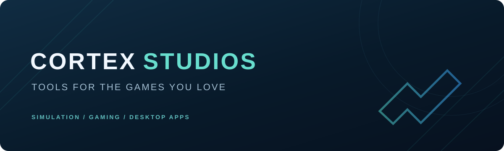

  

<h3 align="center">Built for the way you play.</h3>

  Desktop tools and experiences for simulation and gaming communities.

  
  

 

## What I create

Tools that bring more control and creativity to the games I enjoy—from managing a trucking setup to exploring new looks for a Rocket League garage. The focus is always on a straightforward, enjoyable experience.

## Featured projects

<table>
<tr>
<td width="50%" valign="top">

### 🚛 Truck Manager

One Windows app for your **Euro Truck Simulator 2** and **American Truck Simulator** setup. Organize mods, manage profiles and create custom jobs.

[Explore Truck Manager →](https://github.com/cortexstudiosinfo/ETS2-MOD-MANAGER-UI)

</td>
<td width="50%" valign="top">

### 🚀 RL Customs

Discover new looks for your **Rocket League** garage. Browse items, preview appearances and personalize your selection.

[Explore RL Customs →](https://github.com/cortexstudiosinfo/RL-Customs)

</td>
</tr>
</table>

## In the studio

## Join the communities

[**Truck Manager Discord**](https://discord.gg/UUfsc89HNv) &nbsp; · &nbsp; [**RL Customs Discord**](https://discord.gg/PY5sY6hzB4) &nbsp; · &nbsp; [**Contact**](mailto:cortex.studios.info@gmail.com)

---

Made by Cortex Studios · Built for players

